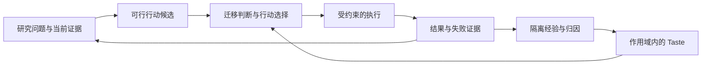

# SciTaste 架构

维护对象是当前组件职责、数据流和约束。实验数值、每日进度和逐次修复记录回到项目台账；完整旧稿见[架构历史快照](archive/snapshots/ARCHITECTURE.pre-20261012.md)。

## 产品与研究对象

SciTaste 是贯穿 Idea、Experiment、Writing、Figure、Review 的科研判断系统。当前产品重点是 Idea Research & Discovery：检索、证据组织、idea 构造与 Taste 指导的改进。长期全流程目标和后续阶段的科学验收条件保留。

FastResearch 保留为本地目录和兼容标识。原生运行时在 `src/scitaste/`；公开产品 workspace 在仓库 `workspace/`，本地迁移布局由其桥接器兼容。外部科研框架是被比较或适配的执行系统，不承载 SciTaste 控制逻辑。

## 组件边界

| 层次 | 源码 | 职责与约束 |
| --- | --- | --- |
| 项目与状态 | `project/`、`state/`、`schema/` | 维护版本、证据、候选行动、决策和投稿计划；当前交付以项目 submission_plan 为准 |
| Idea 与证据 | `discovery/`、`evidence/` | 获取允许的来源、组织证据、构造和修订研究问题；检索结果不自动成为已验证结论 |
| Scientific Taste | `taste/`、`data/` | 保留有来源的决策先例、作用域、反例、检索、迁移判断和归因；未准入经验保持隔离 |
| 决策与执行 | `taste/controller.py`、`executor/`、`model_nodes/` | SciTaste 选择行动，执行器执行受约束的行动；模型建议不能越过预算、数据与执行合同 |
| 写作、图表、审阅 | `writing/`、`visual/`、`review/` | 将已登记主张和证据组织为稿件、图表与审阅反馈；文字改善不代替实验补证 |
| 评测 | `evaluation/`、`benchmark/` | 分开工程验收、开发诊断、独立确认及科学有效性；匹配资源和真实系统身份 |
| 界面与资源 | `generative_ui/`、`resources/`、workspace | 生成有证据约束的视图，展示来源与状态；刷新网页不启动实验或模型调用 |

以上路径相对 `src/scitaste/`，workspace 为独立产品入口。

## 决策与反馈

Knowledge 保存已知事实，Taste 保存“此情境为何选择这个行动”的经验。Planning Taste 冻结库和输入，留下建议及采用记录；Writing contract 有专门检索接点。网页共享经验池是展示投影。通用外部经验自动导入和赛马建议应用仍需显式贯通，详见[经验接入规范](taste/EXPERIENCE_INTEGRATION.md)。

## 核心流程技能

第一方可复用流程随仓库`skills/catalog.json`与`skills/<id>/`分发。workspace的`platform_skills.py`按显式文件清单加载、绑定完整内容SHA，并为执行助手准备任务；`/#/skills`提供规范、模板、技能包和任务下载。首项research-report用于汇报整理。注册/准备不调用模型，也不自动进入原生harness动作选择；科学事实、Taste策略与执行授权仍由原模块维护。

## 数据与信息权威

| 信息 | 唯一维护位置 |
| --- | --- |
| 项目当前任务、依赖与科学交付 | 原生项目 `PROJECT.json.submission_plan` 及项目状态接口 |
| 具体实验当前状态、数值与下一决策 | 对应项目的当前状态、计划与结果台账 |
| 原始预测、配置、请求、账本与评分记录 | 项目 run/artifact 目录；按版本及内容绑定 |
| 跨项目可读进展 | 本地 report 及网页投影，链接原始来源 |
| 通用行为与操作说明 | 本目录按模块维护的文档 |
| 已冻结研究合同 | 原配置指定的路径和 SHA；整理文档不修改它们 |

各入口引用唯一来源，避免同一实验数值在架构、路线图和多份计划中分别维护。

## 不变约束

- 候选、审查、准入、实际采用和有效性是不同状态；写入经验或加载 skill 不产生新的执行权限。
- 开发集、公开测试曝光与未曝光确认分开；结果出来后不能倒造事前冻结或覆盖失败。
- 费用、并发、工具权限及数据隔离由程序和项目合同执行；资源优先级由当前授权决定。
- 真实外部系统运行其原实现；模型/session 替代、骨干、预算与恢复差异需披露。
- 旧冻结版本不因新适配或新结果被改写。新实现与恢复产物关联原失败并分别留存。
- 工程通过、API 可调用、生成论文或 AI 评分都不单独建立科学收益或投稿就绪。

## 继续阅读

- [文档入口与维护分工](README.md)
- [工作流与项目维护](guides/README.md)
- [Taste 与自下而上经验迭代](taste/README.md)
- [评测和科学合同](evaluation/README.md)
- [界面使用说明](guides/GENERATIVE_UI.md)
- [范围与长期验收](ROADMAP.md)
