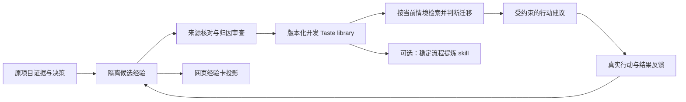

# 子课题经验接入 SciTaste 的规范

版本：1.1，2026-10-12。适用于 Idea、Experiment、Writing、Figure、Review，以及跨子课题赛马。本文约定后续接入方式，不把尚未实现的自动同步描述为现有能力。

经验先保留为有来源的决策案例，再提炼 Taste；稳定、可重复执行的流程才封装成 skill。一次实验涨分、一次修改被认可、一个 skill 文件，都不能单独证明学到了有效的 Scientific Taste。

## 1. 经验、Taste、skill 和程序规则分别存什么

| 对象 | 回答的问题 | 例子 | 维护位置 |
| --- | --- | --- | --- |
| 原始证据 | 当时发生了什么？ | 冻结配置、完整结果、修改前后稿件、评审意见、失败及成本 | 原项目证据与结果台账，保存版本和 SHA256 |
| 经验案例 | 什么情境下，哪些选择被考虑，最终怎样？ | 在已曝光开发集上观察到方向错误后，选择先核协议，而非直接扩量 | 原生候选经验；网页共享池只投影摘要和证据链接 |
| Taste | 在类似情境下，为什么优先某个选择？何时不适用？ | 优先解决影响主要主张的证据缺口；开发收益不足以建立泛化结论 | `TasteCase` / 有来源的抽象与版本化 Taste library |
| skill | 已确定要做这件事时，怎样可靠执行？ | 按研究问题组织结果段；生成同预算分支对比及下一决策 | 被执行器显式加载的 `SKILL.md` 与辅助代码 |
| 程序规则 | 哪些条件必须执行、不能被建议覆盖？ | 费用预留、单 worker、停止条件、确认集隔离、版本校验 | controller / executor / 项目配置与确定性检查 |

例如“预算不得超额”进入程序约束；“优先哪个分支更能区分假设”进入 Taste；“如何汇总赛马证据”适合 skill。知识事实、文献内容留在 Knowledge 库，不强行写成决策偏好。

## 2. 每次有价值的迭代，最少交付一张经验卡

记录触发点为：有结果的决策、失败或停止、方法转向、实质稿件修改及评审反馈。普通轮询、重复检查和未产生新证据的操作无需新增经验。

经验卡必须包含以下内容；这些是填写约定，不是新增运行时 schema：

1. **身份与范围**：项目、子课题、阶段、决策 ID、经验 ID/版本、作者身份、时间、适用任务/模型/投稿场所。
2. **决策时信息**：研究问题、当时可见证据、数据曝光/划分、资源约束；与结果出来后才知道的信息分开。
3. **备选与选择**：至少两个实际考虑的行动、选择了哪个、为何舍弃其他行动。事后补录要标记 retrospective，不能补造事前 LOCK。
4. **结果与来源**：完整指标的分母、有效率、成本、失败、原稿/改稿及意见；链接原项目唯一台账，记录文件版本和 SHA256。
5. **提炼与边界**：候选原则、适用条件、失效条件、反例或能推翻原则的探针；将观察、解释和待验证假设分开。
6. **接入与验证**：接入 Writing / Planning / 赛马的哪个决策点、当前候选/开发可用/正式资格、验证方案和回退版本。

不要把每个字段拼成一篇总结。卡片保留决策差异，原始大文件用内容绑定的链接引用。一次失败同样可以产生有价值的经验；不能只保留赢家。

原生字段映射如下：

| 经验内容 | 现有类型字段 |
| --- | --- |
| 情境、已知证据、备选与选择 | `TasteCase.context_summary/evidence_state/candidate_actions/preferred_action/rejected_actions` |
| 原则与选择理由 | `decision_principle/why_preferred` |
| 适用范围与反例 | `applicability_conditions/failure_conditions/counterfactual_probe` |
| 观测结果及时间尺度 | `outcome_summary/outcome_horizon/source_action_id` |
| Writing 分类 | `writing_level/section_type/rhetorical_role/claim_strength/writing_taste_dimensions` |
| 版本、证据、曝光和归因限制 | `provenance`；扩展说明放 `ProvenanceRecord.metadata`，不向封闭顶层 schema 塞字段 |
| 复用资格与真实审核来源 | `retrieval_eligible/human_verified/label_basis`；初始为不可检索、未经人工核验 |

需要更强的抽象约束时，使用 `GroundedTasteCaseAbstraction`：context、evidence_state、alternatives、choice、decision_principle 都要绑定原文支持；有 outcome 时也要绑定。原则必须是跨至少两个来源字段的对比归纳，并给出迁移边界。不要用主观 confidence 代替证据等级。

## 3. 接入闭环与现有实现



这个图是接入规范；各路径的现有能力和缺口如下。

| 环节 | 已有实现 | 使用边界 |
| --- | --- | --- |
| 原生执行经验采集 | `taste/collect_experience.py` 从 sampling plan、真实 `taste_capture/LOCK.json`、`OUTCOME.json`、`COMPLETED.json` 编译隔离候选 | 需要真实原生执行链；不能直接把任意外部结果 JSON 当成原生决策轨迹 |
| 经验处置与归因 | `taste/experience_disposition.py`、`project/workspace_experience.py` | AI accept 仅到 `pending-admission`；无可归因信用保留 observation-only，不学习行动偏好 |
| AI episode 准入与策略实验 | `taste/episodes.py`、`taste/episode_learning.py`；CLI `prepare-ai-attribution-review → import-ai-attribution-review → admit-ai-reviewed-episode` | 可形成 `AdmittedTasteEpisode`；episode 准入本身不更新策略。现有 fit/assess 路径需要各自分区与合同，heldout 不能参与拟合 |
| 有来源的开发库 | `taste/reviewed_library.py`、`scripts/compile_reviewed_development_library.py` | 核对 source quality、抽象及实际审核链；保留 `human_verified=false`、`formal_evidence_eligible=false` |
| 历史记忆准入 | `taste/memory.py` 的 `TasteMemory.reflect` / admission | 反思先隔离；其 admission 类型明确要求人工审核，不能用子智能体结果伪填 human 字段 |
| 检索和 Planning Taste | `taste/retriever.py`、`taste/controller.py`、`project/planning_taste.py` | planning 冻结 library/hash，先构造候选池，再判断迁移，留下 INPUT/RESULT/ADVICE；不会因此更新策略或建立有效性 |
| Writing Taste | `writing/taste.py`、`writing/venue_taste.py`、[Writing Taste 文档](../WRITING_TASTE.md) | 通用完整性优先于风格；场所 profile 是 advisory，诊断不会自行改稿或授予投稿资格 |
| 写作案例检索 | `writing/contracts.py:retrieve_contract_taste` 与 `CommunicationWorkflow` | 已有 `COMMUNICATION` 阶段下的 `WRITING_DECISION` 策略按段落/修辞角色/主张强度检索，并记录 case IDs；不代表所有写作节点自动加载同一库 |
| 网页共享经验 | workspace 的 `scripts/progress_board.py` 读取本地 `report/EXPERIENCE_POOL.json` | 目前是只读展示投影，不是自动准入、检索或模型训练接口 |

**现阶段推荐走 AI 审核的开发候选路径。** 原生经验处置链和外部来源抽象的开发库路径已有各自合同；二者尚不能视为一条通用、自动的 import/promotion 管道。外部子课题先保留真实来源和 retrospective 标记，再接来源抽象与审核，不伪造原生执行记录。

当前未提供“放一个 skill 文件就自动接入 SciTaste”的通用注册器。要使用 skill，执行端需显式读取其内容，绑定版本，并记录在哪个决策/执行点采用。`SKILL.md` 的存在、网页显示成功和库能加载，分别只证明文件、展示和工程接入完成。

人工审核字段属于旧路径的明确类型约束，不是本规范给日常经验整理增加人工审批。AI 开发路径继续保留真实 AI/session 来源及资格边界；不能把它包装成已获人工或正式实验认可的记忆。

## 4. Writing Taste 的接入规范

把经验拆成三个独立对象：**编辑案例、判断原则、可执行编辑流程**。

编辑案例保存：原段落、修改后段落、修改目的、对应 claim/evidence/limitation ID、读者或 reviewer 意见、结果与出处。以论文版本为单位记录，不能靠“改后更顺”推断科学结论更强。

示例原则：

> 当结果段已有完整证据，却按开发过程叙述时，按研究问题和结论重排，并将构建细节移入附录；保留影响解释的失败和限制。若真正缺少对照或独立验证，应补证据或缩小主张，重排文字不能解决该缺口。

接入方式：

- 通用经验使用 `TasteCase` 的 Writing 字段，阶段采用实际消费端的 `COMMUNICATION`，检索策略为 `TasteRetrievalPolicy.WRITING_DECISION`，二者不可混淆。现有 `retrieve_contract_taste` / `CommunicationWorkflow` 可作为接点；其他 writer/reviewer 仍需显式连接，不能仅写入库后宣称所有写作流程已生效。
- 投稿场所特有的叙事建议进入 `configs/writing/venues/<venue>/taste.yaml`，通过现有 profile 加载、来源绑定与 assessment 使用；官方规则、优秀论文观察和本地编辑偏好分开。不要把经验偏好升格为会议硬规则。
- 可复用步骤才写 writing skill：先读 claim/evidence map → 找段落论证职责 → 提议重排/改写 → 检查数值、引用与限制 → 保存前后版本及理由。一次性项目结论与模型/数据参数留在项目中。
- 诊断器缺失的确定性检查才落代码；语义判断保留有来源的建议和弃权，避免把文风关键词当科学质量评分。

验证时冻结同一证据和稿件，比较不用经验与使用经验的输出。优先看主张准确性、遗漏限制、证据对应和可读性；记录评价者身份与分歧。使用未参与提炼的稿件检验迁移，并检查是否错误削弱了已有强证据的结论。无独立读者时如实标为 AI 开发评估，不能称人评或录用效果。

### 4.1 先写完整稿，再用审稿驱动实验

用户于 2026-10-12 提出的写作经验，作为后续写作任务的默认执行约定：**完整稿 → 目标会议审稿 → 关键实验 → 对照预期与实测 → 重写完整稿 → 重新审稿**。这是用户提出的流程原则，尚无录用率或效率增益实证；不能登记为已验证的 Taste 效果。它指导已授权任务，不因记录此经验自动启动实验。

1. **直接形成完整稿。** 按目标会议终稿体例组织标题、摘要、引言、方法、实验、相关工作、限制与结论，保持全篇一致、可读、可审。正文不添加 `SIMULATED`、TODO、“实验未跑完”等过程标签，也不用开发日志代替论文叙事。数值、比较结果和主要结论仍须有真实来源；先写不要求先获得全部结果，也不允许编造占位成绩。已有证据决定当前稿件可主张的范围，目标证据放在独立的审稿可见条件说明中。
2. **交给目标会议的审稿角色。** 用新上下文子智能体，提供同一版完整稿、必要附录、证据说明和有出处/版本的会议审稿模板；不传作者希望中稿的结论、先前好评或赛马排名。尚未公布当届模板时使用最近官方模板并注明沿用版本，不能杜撰当届评分规则。记录稿件/附件 SHA、模板来源、会期、实际 session 身份及完整意见；新上下文不等于真实外部独立专家。
3. **把“能中稿”拆成可检验判断。** 审稿分别判断：在明确证据条件成立时，问题、创新和论证是否具有竞争力；当前实际证据是否足以支持这些主张。推荐与信心按模板填写，保留拒稿、分歧和未知；条件性正评不代表实验成立，也不是录用保证。若方法或问题本身不足，先修改方法/定位；若证据不足，将关键疑点转为实验任务。
4. **按科学缺口跑实验。** 将每条重要意见映射为 claim ID、可证伪假设、最近已录用强对照、信息/预算匹配控制、数据划分、指标、停止条件及投稿计划 work ID。通过既有项目权限与资源门后执行；最新预印本用于探索，不冒充已录用对照。审稿好评不能绕过预算、数据隔离或失败分支停止门。
5. **实测偏离预期就重写。** 逐项记录目标证据与实测之间的一致、零收益、退化、矛盾、未定或执行失败。关键机制不成立时修改方法、收窄主张、换路线或停止该版本；将真实结果写回摘要、主表、图、限制和结论。不能只补正向证据或反复调测试集来匹配先写好的故事。
6. **实质修改后重新审稿。** 冻结新完整稿及证据包，再按同一模板审查；可由原角色核查问题关闭，并由新角色评估整稿。保存每轮版本、全体意见和未关闭问题。没有新证据或实质改稿时，不重复抽取评审直到抽到好评。循环的退出依据是项目科学验收与真实投稿要求；AI 推荐本身不能授予投稿资格。

条件说明与稿件分开保存，但必须随稿给审稿角色：逐个 claim 列出已有证据及来源、尚需验证的假设、必要实验与可推翻结论的结果。正文不堆过程标签并不意味着可以隐瞒影响判断的限制；缺失证据的目标主张只能得到条件性评价。实验完成后用真实证据更新说明，旧条件与旧稿保留。

### 4.2 可复用的审稿任务

```text
请作为 {会议/年份} 的审稿人，使用附件中的 {官方模板及版本}，
客观审阅 {稿件版本/SHA} 和全部审稿附件。不要预设接收或拒绝。
先核对证据说明；将条件性目标与真实实测区分，不把目标当成结果。
按模板完整给出总结、优点、缺点、问题、建议与信心，并引用稿件位置。
分别回答：
1. 若明确列出的证据条件成立，该研究是否有竞争力？为什么？
2. 目前的真实证据是否支持稿件主张？哪些关键问题仍未解决？
指出最能改变判断的实验、强对照或反例；证据矛盾时建议如何修订主张。
保留无法判断的事项。你是内部 AI 审稿角色，不代表该会议官方决定。
```

作者回复与修订另行提供原意见及逐条证据；整稿新审稿角色不接收作者期望的评分。评审模板的核实发生在真实审稿任务中，本文不声称已取得任何会议当届模板或执行了审稿。

### 4.3 接到 SciTaste 的位置与每轮最小记录

每轮复用项目已有的稿件、审稿与实验记录，不新增一套状态台账。保存：稿件和证据包版本/SHA、模板来源与审稿 session、完整评审、意见到实验/主张的映射、实测偏差、重写理由、下一动作和未闭合问题。稳定经验再按第 2、6 节进入候选库，不把用户指定流程本身当成经验效果的观测。

现有 `PaperArgumentContract` 可表示主张与 planned/available/unavailable 证据载体；`EvidencePaperDraftInput` 绑定证据与可用数值；`VenueReviewPacket` 和 `VenuePaperReviewMaterial` 绑定确切稿件及审稿输入。已注册评审可经 `project paper review route-state → plan-iteration → design-followup` 形成问题与后续实验依赖，之后按实际结果闭合问题、修订并复审。沿用各自合同；计划不自动成为 evidence，改写不自动关闭实验问题。

这条流程目前进入维护者约定及共享经验展示，**尚未实现“自动写整稿—派审—跑实验—再写”的通用调度器，也未自动将该原则设为可检索 Taste**。当前原生写作入口仍要求合法的已知证据与主张；实验前的目标论证和条件包由项目显式保存，不能伪装成已准入的实测稿件来绕过入口。

## 5. 赛马经验的接入规范

赛马以原生项目 `submission_plan` 的科学交付为主记录。分支视图链接同一份结果和证据，不另造一套互相竞争的“最新状态”。

每个分支至少展示：研究假设、最近已录用对照、最新探索邻居、模型为何这样选、数据与曝光、预算/停止扩展门、完整结果、当前决定、下一判别实验、投稿 work ID 和尚缺的科学证据。区分准备中、实际运行、评分待办、负向停止、开发可继续和独立确认；阶段推进不能直接换算成论文完成百分比。

示例原则：

> 当一个分支有开发收益但替代解释尚未排除时，优先做能区分机制与额外预算/信息收益的对照；开发收益只能触发下一决策。若其预设停止条件失败，保留负结果并关闭该版本，新的任务有空间不能自动复活旧版本。

接入方式：

- 预算、并发、完整性、固定划分与停止门进入可执行配置/controller；Taste 的排序建议不能覆盖它们。
- 分支排序建议复用 Planning Taste 的候选池、迁移判断与日志机制。现有通用 planning 行动不是完整赛马策略；后续需要显式的 branch/action projection 与决定应用接口，不能声称当前网页已经自主赛马。
- 排序同时考虑科学缺口、区分假设的信息价值、对照强度、可执行性、成本和投稿适配；不把不同任务的原始 accuracy/F1 直接混排，不硬套未经校准的综合分。
- 实际日志需记录检索到哪些 case、采用/拒绝哪些原则、改变了哪个行动、消耗及最终结果。未采用与弃权也记录，便于检查过度迁移。
- 源自测试集反复查看或调参的窍门必须记录曝光和每次选择；该集合转为开发集，确认用预先隔离且未参与调参的样本/来源。可以研究公开开发集调参效率，不能继续称无泄漏的测试收益。
- 正式对照的录用/track、原方法模型与实际 API 适配差异单列；最新 arXiv/ICLR 探索身份单列。模型优先列表不等于排他白名单。

验证赛马 Taste 时，冻结候选分支、可见信息和总预算，对比无经验、普通结果排序、Taste 建议。检验是否更早解决关键科学疑点、减少无效消费、提高未曝光任务上的最终质量；不只看选择了多少分支。历史日志重放只能验证一致性，不能把已知结局的事后选择当成前瞻有效性。

## 6. 晋升、版本与回退

采用四层标记，网页展示标记不自动改变执行资格：

| 标记 | 所需事实 | 可以怎样用 |
| --- | --- | --- |
| 观察 | 来源与完整结果可追溯，未建立偏好归因 | 检索事实、报告展示；不学习赢家偏好 |
| 候选原则 | 有对比选择、支持证据、适用与失效条件 | 隔离审核、设计验证；`retrieval_eligible=false` |
| 开发可用 | 通过对应路径的真实来源/审核合同，冻结库和版本 | 在声明的开发范围建议行动，保留日志与弃权；不自动获得正式证据资格 |
| 迁移验证 | 在未参与提炼的任务/稿件有匹配对照和完整结果 | 可报告限定范围的有效性；正式资格仍服从具体实验协议 |

这四层是产品与维护语义，不是替代已有 admission 类型的通用状态机。不得手改 `retrieval_eligible=true` 绕过准入实现。

一个原则一个稳定 ID，修订产生新版本并关联 supersedes/reason/evidence。保留旧负结果和旧库 hash；运行期间库不变。出现反例时收窄范围、降级或停用，回退绑定旧版本；不覆盖旧记录来制造“当时已正确”的历史。

Skill 同样保留 ID/版本、触发条件、输入/输出、步骤、依赖与资源边界、失败/弃权、来源案例及回归样例。原始预测、GT、密钥和不可再分发源码不放 skill；脱敏后的程序与模板可以随产品发布。每次使用绑定 skill 版本，不因 skill 的指示扩大调用、训练或发布权限。

## 7. 后续产品接入顺序

1. **先统一记录与展示**：复用原项目证据和经验池，增加适用范围、证据等级、验证状态、被哪些阶段使用；展示层指回 canonical case。本文与示例完成此规范定义，尚未实现自动导入。
2. **再贯通消费端**：为 Writing 和赛马增加明确的经验输入投影、版本绑定、采用/弃权记录；保留现有约束和数据隔离。先解决真实使用链，避免重复建设经验库。
3. **最后评估增益**：冻结一个小而真实的候选库和未参与提炼的任务，在相同预算下测不用经验/普通检索/Taste；有效后扩大适用范围，再将稳定过程提炼为 skill。

日常可以直接给维护者这样的任务：

> 将这次迭代整理为 SciTaste 候选经验。项目/阶段是……；当时考虑了……，选择……；证据在……；结果和反例是……。请先保留原始来源及曝光，再拆出可迁移 Taste、程序规则和可选 skill；接入 Writing/赛马的……决策点，未经验证不要标为已学会。

可填写示例见 [Writing 与赛马候选](../../examples/experience_integration/candidates.jsonl)，来源见 [合成来源样例](../../examples/experience_integration/sources.json)。两例均为**合成模板、不可执行检索、没有真实结果或正式资格**，仅展示现有 `TasteCase` 字段，不自动导入任何库。
